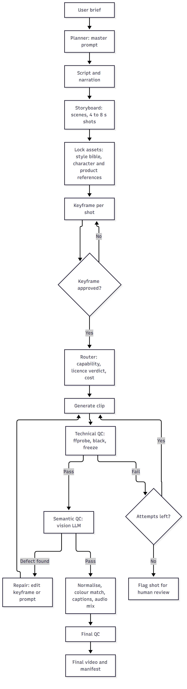
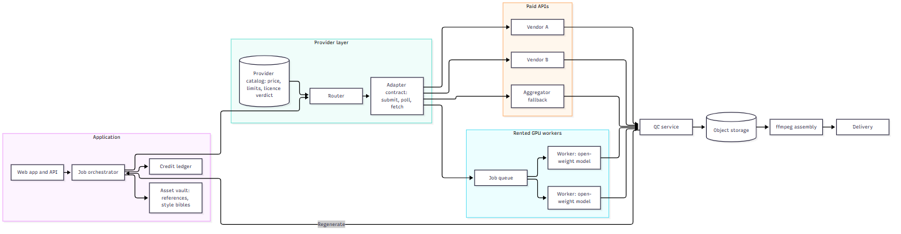

# Video Production Architecture

**As of 2026-11-01.** Written for engineers reviewing the design. Everything here is `[DESIGN]` unless a test is named. [Doc 07](07-demo-plan.md) shows what runs today.

## Summary

A 5-minute video is a production pipeline, not a prompt. The design breaks it into 38 to 75 short shots, approves a keyframe before spending on video, checks each clip automatically, and assembles the result with ffmpeg. All providers sit behind one adapter, so a provider can be replaced without touching the pipeline.

## Long-form workflow

| Stage | Output | Gate | Failure handling |
|---|---|---|---|
| 1. Creative brief | Validated brief, assumptions list | Schema | Ask the user, or record an assumption |
| 2. Script | Narration, one line per beat | Duration fits | Rewrite |
| 3. Storyboard | Scenes and 4 to 8 s shots | Durations sum to target; all ids resolve | Replan |
| 4. Asset lock | Style bible, character and product references | Human approval | User edits |
| 5. Keyframes | One approved image per shot | Vision check and approval | Regenerate the image, which is far cheaper than video |
| 6. Clips | One accepted clip per shot | Two-stage QC | Repair, regenerate, reroute |
| 7. Final video | Normalised, colour-matched, captioned master | Final QC | Fix the shot, then reassemble from cache |

R4 supports this order: plan, lock assets, keyframe, animate, QC in two stages, repair, assemble (R4-036, R4-041, R4-049, R4-058).

Durable state matters. A 5-minute job has dozens of paid steps, so each passed shot is cached by a hash of its prompt, references and spec, and a failed job resumes without repeating them. [REAL: test_resume_reuses_passed_shots] [REAL: test_changed_references_are_not_served_from_cache] The cache must be per tenant, since the key holds no tenant.

**Accept rate decides feasibility, not only cost.** At a 25% accept rate and 3 attempts, about 42% of shots exhaust their attempts, so a 60-shot run practically never finishes unaided, and about 25 shots need reroute or a person. At 85%, about 82% of runs finish unaided. [WB:Sensitivity] Reroute is `[DESIGN]`, not built.

## Character, product and style continuity

**One source of truth.** Character profiles, product references and the style bible are stored once in an asset vault, and shots refer to them by id. The compiler copies canonical descriptions and reference images into each shot. [REAL: test_every_prompt_carries_canonical_references] proves propagation, not visual consistency.

| Asset | Contents | Used for |
|---|---|---|
| Character profile | Canonical description, wardrobe, multi-angle references, voice | Keyframes, identity QC |
| Product reference | Canonical description, approved images, exact text | Keyframes. Logos and text are composited at assembly |
| Style bible | 3 to 5 colour palette, lighting, lens, exclusions | Every shot, plus a shared finish at assembly |
| Continuity record | Who appears where, last appearance, wardrobe state | Warns when a character returns after a long gap |

**Methods, in order of evidence**

1. **Keyframe-first.** It spends on an image before video, which is cheap either way. Its strongest evidence is for face swap on keyframes, which this design does not include: see [doc 02](02-master-prompt.md). That method fails on motion blur and extreme poses (R4-037). Plain image-to-video identity must be measured in the pilot.
2. **Reference images.** They help but do not solve identity. ArcScore stayed near 0.67 to 0.70 on Seedance 2.0, and named failures include copied pose and fading detail (R4-032, R4-038).
3. **First and last frame.** Use only for continuous action. No paper measures user-level last-frame chaining, so this is caution, not a finding. A research model's quality halved over 180 s of its own rollout (R4-045).
4. **LoRA per character.** Optional for recurring brand characters. No controlled evaluation exists (R4-042).

**Known risks.** Returning characters are the main long-form risk (R4-034). Product consistency has little direct evidence beyond vendor guidance (R4-043). The pilot must measure both.

## Quality control

QC runs in two stages, cheapest first (R4-049, R4-058).

| Stage | Checks | Tool | Status |
|---|---|---|---|
| Technical | Duration, resolution, stream presence, black frames, frozen frames | ffprobe, ffmpeg filters | [REAL: test_qc_catches_each_injected_fault] [REAL: test_qc_fails_a_file_with_no_video] Silence is checked on the final video only |
| Semantic | Action matches prompt, identity, product fidelity, text legibility | Vision LLM, OCR, face embeddings | [DESIGN] returns `not_evaluated` in the POC |
| Final | Total duration, audio, captions, loudness | ffprobe, ffmpeg | [REAL: test_five_minute_mock_run], except loudness |

**What the evidence supports.** Technical checks are well served by ffmpeg, though default filter durations of 2 s must be tightened for short shots and thresholds confirmed (R4-049). The POC's thresholds are tuned to its mock clips. Semantic QC is usable but weak where it matters most. Vision LLMs reach rho 0.72 to 0.86, but consistency correlation is about rho 0.60 and temporal about 0.40, and these are model-level correlations, not per-clip accuracy (R4-052, R4-053, R4-054). VMAF cannot score a raw generation (R4-050). DINOv2 should not gate identity (R4-035). ArcFace is noisy and sensitive to viewpoint (R4-039, R4-040).

**Identity and lip-sync licensing.** InsightFace pretrained models are non-commercial research only, and they sit inside the usual identity gate, LivePortrait, LatentSync, Hallo2 and IP-Adapter-FaceID (V-015, V-016, V-018, V-020, V-022). Using them in a paid product needs an InsightFace licence or a replacement that is then re-tested. No licensed replacement has been selected, so the identity check has no named component and stays `not_evaluated`. Choosing one is a 30-day item in [doc 08](08-roadmap.md), because the pilot needs it to measure the main long-form risk. Lip-sync starts on a paid API. MuseTalk 1.5 weights look usable, but its components have not been checked (V-017). `[COUNSEL]`

**Thresholds.** No published threshold is reliable for per-clip gating. VBench and VBench-2.0 do not publish the cut-offs in the earlier report (V-513, V-514, V-515). VBench's composite uses a 4:1 quality to semantic weighting (V-912), but that ranks models across a benchmark. It is not a per-clip gate, so it is not used here. Thresholds must be calibrated on hand-labelled pilot clips, not copied from a paper or from the earlier reports. Humans disagree too (alpha 0.273, R4-055), so a sampled human review stays in the loop.

**Repair loop**

1. The vision LLM names the defect and the segment (R4-058).
2. If the fault is in the keyframe, edit and regenerate the keyframe.
3. If it is in the motion, change seed or prompt and regenerate.
4. After a capped number of attempts, reroute to another provider. [REAL: test_attempts_are_bounded_and_run_fails_cleanly] covers the cap.
5. If it still fails, send the shot to a human rather than ship it.

## Final editing

Normalise all clips to one resolution, frame rate and pixel format. Match colour and apply one shared finish. Burn in text and logos at this stage. Mix narration, music and effects with ducking, and set loudness (R4-047, R4-069, R4-070, R4-072, R4-074, R4-075, R4-076). Automated shot matching across AI clips has no published method, so colour matching starts simple.

## Production architecture

**Adapter contract.** Every route implements `capabilities`, `estimate_cost`, `submit`, `poll` and `fetch`. This models async jobs, which is how paid APIs and GPU workers both behave. [REAL: test_adapter_contract] runs the same tests against all three adapters; the API and local adapters run against fake servers only.

**Router.** Filters the provider catalog by capability, licence verdict and cost, then takes the cheapest eligible route. A `Blocked` route can never be selected, and a `Counsel` route needs an explicit opt-in, so the default today is Wan 2.2. [REAL: test_real_catalog_routes_only_to_allowed_and_rejects_blocked] [REAL: test_router_excludes_counsel_routes_unless_accepted] Cheapest-first ignores quality, which needs pilot data.

**Provider risk controls**

- Two live routes per tier is the goal. It cannot be met on `Allowed` routes today: no API route is clear, so this depends on counsel. Veo's GA retirement date is listed as "November 17, 2026 or later" (R1-021), so nothing assumes a model will last.
- A spend cap on every paid adapter. [REAL: test_api_adapter_enforces_spend_cap]
- Rate limits are a real constraint. Runway Tier 1 allows 1 to 2 concurrent jobs (R1-048, R1-049), so an early 5-minute job needs a higher tier or a second provider.
- Failed-job billing differs by vendor (R1-050, R1-084, R1-095, R1-115). The ledger must reconcile against what each provider actually billed.

**API vs local.** Start on APIs. Self-hosting is added per route only when the [Breakeven sheet](06-gpu-deployment-cost-assessment.md) justifies it after engineering cost, and after a quality comparison.

**Local production design** `[DESIGN]`

| Part | Design |
|---|---|
| Worker | One container per model, pinned weights, one job at a time per GPU. Headless ComfyUI or Diffusers behind a small HTTP service matching `LocalAdapter`, which asks for 4n+1 frames as Wan expects (V-910) [REAL: test_wan_frame_counts_follow_4n_plus_1] |
| Queue | Durable job queue, per-tenant fairness, idempotent job ids so a retried job is not billed twice |
| Scaling | Scale on queue depth. Keep weights on a network volume to cut start time, and measure cold starts (R3-020, R3-021) |
| Failure | Heartbeat per job, requeue on GPU loss, capped retries, then reroute to an API |
| Data | Inputs fetched per job over TLS and wiped afterwards. Secure Cloud only, never community or marketplace GPUs (R3-029, R3-054, R3-055) |
| Capacity | Cap GPUs per engineer. The Scale tier's 222 GPUs is arithmetic, not an operating plan |

`LocalAdapter` speaks this invented contract and has only met a fake server.

**Long-form candidates for the pilot.** Sliding-window generation, RIFLEx, SkyReels Diffusion Forcing, Phantom, VACE reference injection and camera-control models are untested options. Their claims were not verified, so none is part of the design until the pilot measures it.

## Data handling in the video pipeline

Tenant isolation is a Social 360 test result. It does not cover this pipeline, which has no tenant concept in the POC. The launch plan also sends customer data to third parties: character references, product images, scripts and voices go to the video, image, voice and LLM vendors.

| Question | Position |
|---|---|
| Which vendors see customer assets? | Every API in the route, so each is a sub-processor to list in the customer DPA |
| Do they train on inputs? | Runway's terms say inputs may be used to train its models (V-903). Paid Gemini API terms differ from unpaid (V-529). Others were not analysed |
| Retention at vendors | Not researched |
| Residency | Not researched. RunPod prices were region-unspecified. EU customers will ask |
| Retention at Synquic | `[DESIGN]`: assets kept for the project, then purged after an agreed period (3 months in the cost model) |

Until the sub-processor table is complete, do not send real customer assets or real people's likenesses through the pipeline. `[COUNSEL]`

**Licence position.** See [doc 01](01-video-models-and-pricing.md). In short, Wan 2.2 is the clean open-weight default. LTX-2.5 needs a conversation with Lightricks. Open-weight MiniMax H3 and HunyuanVideo 1.5 are Blocked for a US or EU product (R2-002, R2-025, R2-045, R2-059). `[COUNSEL]`

**Disclosure.** The EU AI Act Art. 50 obligations have applied since 2 August 2026, and a system launched now gets no grace to 2 December 2026 (R7-054, R7-055). The product should ship with C2PA and a watermark on by default, and a disclosure default for synthetic people (R7-060, R7-070, R7-077). `[COUNSEL]`

## The first thing to build next

A pilot of 50 to 100 representative shots across 2 or 3 models, logging attempts, rejection reason and accepted seconds, with defects labelled by hand. It replaces the accept-rate assumption, calibrates QC thresholds, and settles the unit economics in [doc 06](06-gpu-deployment-cost-assessment.md).
