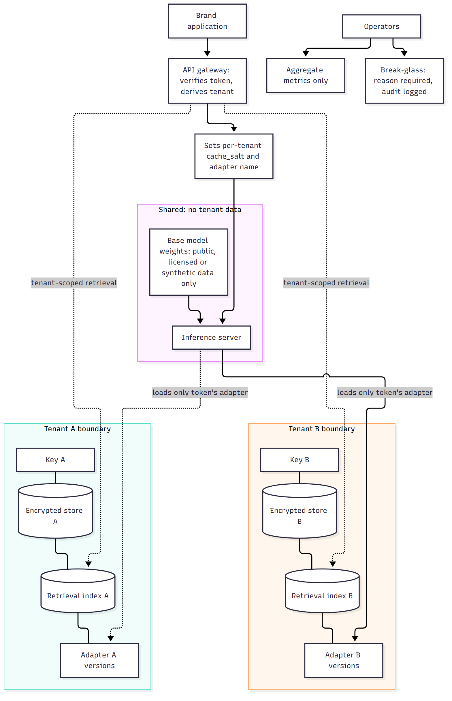

# Social 360 Architecture

**As of 2026-11-01.** Written for engineers and diligence reviewers. Everything here is `[DESIGN]` unless a test is named. Legal readings are `[COUNSEL]`: research for a lawyer to review, not legal advice.

## Summary

Social 360 is proprietary adapters, a data pipeline and an evaluation suite, built on an open-weight base model under its licence. It is not a foundation model built by Synquic.

- **Base:** Gemma 4 31B under Apache 2.0, with Qwen3.8-27B as fallback, subject to a bake-off.
- **Brand knowledge:** a separate retrieval store per brand. This is the core of the product.
- **Brand voice:** an optional per-brand LoRA adapter, kept only if it beats a few-shot prompt on that brand's held-out data.
- **Isolation:** brand data never reaches the shared base.

Three findings shaped this more than anything else:

1. **Platform terms limit training far more than the brief assumed.** Plan on no platform API data in the base, and little or none in adapters.
2. **Adapters have not been shown to help brand voice.** No study tested it directly, so they must earn their place per brand.
3. **Shared-process serving is a security decision.** vLLM warns against production runtime loading outside isolated, trusted environments, and tenant cache separation is optional and off unless set.

## 1. Base model selection

| Model | Licence | Type | Context | QLoRA training | Hosted in/out USD per Mtok | Role |
|---|---|---|---|---|---|---|
| Gemma 4 31B | Apache 2.0, Allowed (R5-032) | 30.7B dense (R5-033) | 262,144 (R5-034) | Unsloth 22 GB; Axolotl about 25 GiB (R5-041) | 0.10 / 0.34 on FP4, which adapters cannot use; 0.40 output on BF16 (R5-042, R5-043) | **Primary** |
| Qwen3.8-27B | Apache 2.0, Allowed (R5-049) | 27B dense (R5-050) | 262,144 (R5-051) | Unsloth 24 GB; Axolotl's nearest 27B config about 47 GiB (R5-058) | 0.15 / 1.875 on BF16 (R5-061, R5-062) | **Fallback** |
| Muse Glimmer 30B | Apache 2.0, Allowed (R5-068) | 29.6B dense (R5-069) | 131,072 (R5-070) | Unsloth 24 GB (R5-076) | 0.35 / 1.50 (R5-077, R5-078) | Fallback if customers bar Chinese-origin models |
| gpt-oss-20b | Apache 2.0 plus usage policy (R5-006, R5-008) | 20.91B MoE (R5-014) | 131,072 (R5-015) | Unsloth 14 GB; BF16 LoRA 44 GB (R5-023) | 0.075 / 0.30 (R5-027, R5-028) | Not the primary. Candidate for synthetic data, and worth including in the bake-off |

**GPT-OSS, which the brief named.** It means OpenAI's gpt-oss-120b and gpt-oss-20b, released 2025-08-05 (R5-001, R5-002). The licence is fine. It is not the first choice for two reasons. Its expert weights ship in MXFP4 and must be dequantised for training outside Unsloth (R5-023, R5-024). And it is an MoE model: Unsloth advises against QLoRA on Gemma's MoE variant, and TensorRT-LLM rejects quantised bases for routed-expert MoE LoRA, though that is not a vLLM limit (R5-041, R5-105). Its 14 GB QLoRA figure is the lowest here, so the case against it is indirect and a bake-off could overturn it. It stays useful as an Apache-licensed generator of synthetic data. Keep "GPT" out of product names, and imply no OpenAI affiliation (R5-010).

**Why dense.** vLLM lists LoRA for all of these architectures, including GPT-OSS, so that does not separate them, and a tick does not cover a quantised checkpoint (R5-102). Dense is preferred on the indirect MoE evidence above.

**Why Gemma over Qwen: a close call.** Both are Apache, dense and similar in memory. Gemma leads on stated language coverage, on hosted BF16 output price, and on a published Axolotl config at about half the memory (R5-040, R5-041, R5-043, R5-062). Qwen is the only one of the two with an independent score, 20 on one index, where Gemma shows none (R5-065). The selection rests on licence and adapter fit, not task accuracy: no model card reports a social or brand benchmark (R5-107). A bake-off decides.

**Earlier reports.** Qwen2.5-14B and Llama-3 are superseded for this purpose. Llama is not Apache: Llama 2 has its own community licence, and Llama-3 also bars improving other LLMs (V-516, V-517). Claude is a hosted service, not an open-weight option. DeepSeek-V3 weights are under a licence with use restrictions (V-520).

**Open checks.** Whether vLLM applies LoRA on FP8, NVFP4 or QAT bases is undocumented (R5-104). If it does not, serving needs BF16 at about 56 to 62 GB, so an 80 GB GPU (R5-037, R5-054). This decides GPU size, and one adapter smoke test settles it. Whether Gemma's older Prohibited Use Policy binds Gemma 4 is a question for counsel, though the Terms point away from it (V-522, V-523).

**Shared base at launch: unmodified.** Do not fine-tune it. That removes the data-rights risk in the base and keeps GPAI provider duties at bay (R7-065, R7-067). Any later domain tuning uses licensed data only.

## 2. Training strategy

| Layer | Holds | Update | Evidence |
|---|---|---|---|
| RAG, per brand | All facts: products, campaigns, documents, recent performance | Daily | RAG beats fine-tuning for facts (R6-017, R6-019) |
| Few-shot examples | Voice samples chosen per request | Daily | The baseline every adapter must beat |
| LoRA adapter, per brand | Voice and style only | Triggered and gated | Fine-tuning beat prompting on sentiment transfer and detoxification (R6-021), and prompted LLMs struggle with implicit style (R6-022). Neither tests brand voice, and small-data QLoRA showed limited utility (R6-020) |
| Shared base | General ability | Pinned revision | Does not learn from tenants |

Adding fine-tuning to RAG lowered accuracy in one study, 0.875 to 0.830 (R6-018), though training with retrieved documents may avoid that (R6-024). This is why facts stay out of weights.

**Tooling.** Axolotl or Unsloth on PEFT, all active with QLoRA support (R6-001, R6-002, R6-003, R6-009). Rule-of-thumb minimum is 100 examples and 1 to 3 epochs (R6-005, R6-006). OpenAI is winding down fine-tuning, which is one reason to own this layer (R6-008).

**Rank.** Fix one rank across the fleet: mixed ranks raised P95 TTFT by 84% (R6-043). Lower rank memorises less (R6-058), so start low.

The automated workflow, gates and versioning are in [doc 05](05-automated-learning-workflow.md).

## 3. Data pipeline and data rights

The brief asks for automatic daily collection of approved brand data. That works for retrieval and reporting. It does not automatically extend to training.

| Data source | Shared base | Brand retrieval and reporting | Brand adapter |
|---|---|---|---|
| Licensed or public-domain corpora, rights checked | Yes | Yes | Yes |
| Brand first-party material outside platforms (CMS, DAM, master files), under contract | No by default. Opt-in only, and makes Synquic a GDPR controller (R7-040, R7-041) | Yes | **Yes: the primary source** |
| Brand data from platform APIs | No (R7-002, R7-005, R7-008, R7-017) | Yes, per tenant, within each platform's storage limits | X and LinkedIn: No (R7-005, R7-008). Pinterest: treat as No (V-536). Meta and YouTube: Conditional and narrow (R7-001, R7-016). TikTok, Reddit: unread, plan as No |
| Public third-party platform data, including competitors | No (R7-006, R7-009, R7-014, R7-021) | Not without review of each platform's terms | No |
| Hosted LLM outputs as synthetic training data | No | n/a | No |
| Apache or MIT open-weight model outputs | Allowed (R7-033, R7-034, R7-035) | n/a | Allowed |

Notes on that table:

- **Only X and Pinterest have express AI clauses.** The Meta, LinkedIn and YouTube "No" readings are inferences from purpose and derived-data limits. The X, LinkedIn and Meta bars have no own-data carve-out (R7-003, R7-007, R7-010, V-528).
- **YouTube's Conditional is generous.** Its rules on derived data and 30-day storage still apply (R7-014, R7-015, R7-016).
- **Hosted LLM outputs.** OpenAI, Anthropic and Google Cloud terms restrict this. The Gemini API bars developing competing models, and separately bars training on Grounded Results and Maps data; the Llama API bars models competing with Meta's (R7-027, V-529, V-530, V-040). A brand LLM product may well compete, so the plan stays self-hosted synthetic generation only. Anthropic's Usage Policy shows an effective date of 12 November 2026, so the version in force today was not read.
- **TikTok and Reddit terms could not be read** after retrying official hosts (R7-012, R7-013, R7-019, R7-020). A person must read them before this table is final.
- The earlier reports' pipeline, training adapters on telemetry from five platforms and on competitor content, is not supportable as written.

**Daily flow** `[DESIGN]`

| Step | Design |
|---|---|
| Consent | Brand authorises each source by OAuth or upload, and records what it approved and the basis |
| Schedule | One scheduled job per tenant per source, with retries and a dead-letter queue |
| Connectors | One per source, each carrying that source's storage and deletion rules |
| Processing | Redact PII with an NER-based redactor, encrypt, then update that tenant's retrieval data |
| Tagging | Each record is tagged with source and training eligibility |
| Expiry | Per-source TTL. YouTube's 30-day rule and LinkedIn's ten-day duty need deletion jobs (R7-008, R7-016) |

Tagging is the mechanism that enforces the table. Source tagging and the eligibility filter are built. [REAL: test_platform_api_data_is_stored_but_never_trained_on] Connectors, scheduling, consent records and TTLs are not: "daily" in the POC is a Python loop over simulated days.

## 4. Privacy and compliance

| Requirement | Control | Status |
|---|---|---|
| Tenant comes from the token, never the request | Gateway derives tenant | [REAL: test_01_token_cannot_name_another_tenant] |
| Per-tenant storage and keys | Per-tenant key in the POC; KMS envelope encryption in production | [REAL: test_03_stores_are_keyed_and_encrypted] demo cipher; KMS is [DESIGN]. Adapters and metadata are plaintext in the POC, and insights hold tenant vocabulary, so production must encrypt them too [DESIGN] |
| Retrieval scoped to tenant | BM25 per query over that tenant's records, no shared index | [REAL: test_02_retrieval_returns_only_own_records] A real vector index per tenant is [DESIGN] |
| Detectors fire on planted leaks | Negative controls | [REAL: test_08_negative_control_detectors_catch_a_real_leak] [REAL: test_08a_log_detector_catches_content_in_telemetry] |
| Version strings cannot reach another tenant | Validated names, never paths | [REAL: test_04b_version_strings_cannot_traverse] Found by review, then fixed |
| No raw content in logs | Salted hashes and counts. Break-glass reasons are stored verbatim | [REAL: test_07_logs_and_metrics_hold_no_content] |
| No unnecessary human access | Aggregate metrics, break-glass with reason and audit | [REAL: test_09_admin_sees_aggregates_only_and_break_glass_is_audited] |
| Offboarding | Delete data, adapters, registry and key, drop loaded models, refuse the tenant's tokens, never reuse its id | [REAL: test_10_offboarding_removes_everything] [REAL: test_10b_offboarded_ids_are_never_reused] |
| Tenant data never changes the base | Frozen base, hash checked | [REAL: test_tenant_training_never_changes_the_shared_base] |
| Cross-tenant leakage in adapters | Literal canary scan today; generated canaries on the real model in production | [REAL: test_08b_leakage_gate_blocks_promotion] finds a canary written into the artefact. It cannot find one learned by the weights [REAL: test_08c_byte_scan_limit_is_real]. The LLM probe is [DESIGN] |

**How far the isolation evidence goes.** No cross-tenant path was found through the current HTTP routes, after review found and fixed two paths at the code level. That is application-level testing on one machine, by the same AI process that wrote the code. It is not a penetration test or a proof. `check_bytes` cannot read ciphertext, so stores are checked by decrypting them. Cloud IAM, network, GPU memory and a shared serving process are not covered, and are `[DESIGN]`.

**"No human access" has limits.** Support and incident response need a route in, so the design is break-glass, audited and rare, not zero. Say "no routine human access". Production break-glass needs a second approver and an expiry, which the POC lacks.

**Retention, residency and sub-processors** `[DESIGN]`. Not researched in depth. Each tenant needs a stated retention period per source, a region, and a list of sub-processors. If retrieval or synthetic data uses any hosted API, that vendor is a sub-processor. RunPod prices were region-unspecified, and its SOC 2 coverage varies by workload, region and provider (R3-027). These are likely to be the first questions from an EU or enterprise buyer.

**Weights are personal data until shown otherwise.** Presume adapter weights hold personal data, so deletion must reach them (R7-036, R7-047). LoRA reduces membership inference risk but does not remove it. Against full fine-tuning, one study found 17.6% against 99.0% TPR at 1% FPR on XSum, but leakage depends on the data: on AG News the same LoRA setup reached AUC 0.961 and 46.7% TPR, and short social posts may sit at that worse end (R6-054, R6-055). Claims that LoRA is comparable to differential privacy are empirical, not a guarantee (R6-056). Per-brand adapters make deletion practical, because deleting the file removes the tenant's weights. Practitioner guidance doubts deletion from shared models is workable, though that is one secondary view (R7-089).

**Regulatory position** `[COUNSEL]`

- **GDPR.** Plausibly a processor for adapters on a brand's instructions, and a controller if pooling brand data (R7-040, R7-041). Plan a DPIA (R7-042). The GDPR Omnibus is not law (R7-043).
- **EU AI Act.** Fine-tuning under Synquic's name makes it a system provider (R7-059). The GPAI threshold is modification compute above one third of the original (R7-065), so ordinary adapters should stay under it. Whether adapters aggregate is unresolved in the passages read. Log FLOP per run.
- **India DPDP.** Substantive duties are reported for May 2027, and sources conflict (R7-051, R7-052).
- **SOC 2.** Type 1 for first enterprise deals, then a Type 2 window. All figures are vendor-sourced: Type 1 about 1 to 6 months, Type 2 about 6 to 15 (R7-082, R7-083, V-532). Say "designed to support" until a report exists.

## 5. Training infrastructure

Use rented GPUs on demand, per training job.

| Job | GPU | Rate | Note |
|---|---|---|---|
| Adapter training | L40S, 48 GB, Secure Cloud | $1.09 per hour (R3-003) | Fits Unsloth's 22 to 24 GB. Axolotl's 47 GiB on the nearest Qwen config is tight, so confirm in the timing test (R5-058) |
| Inference | A100 PCIe, 80 GB, Secure Cloud | $1.79 per hour (R3-005) | Fits BF16 serving if quantised LoRA fails |
| Fallback inference | H100 SXM | $3.99 per hour (R3-007) | |

Secure Cloud gives per-second billing, no egress fees, a public DPA and vendor-stated SOC 2 Type II; no report was read (R3-022, R3-026, R3-027, R3-028). Keep tenant data off community and marketplace GPUs (R3-029, R3-054, R3-055). Do not budget on spot: RunPod retired it, and interruptible capacity elsewhere is unreliable (R3-012, R3-078, R3-089).

**Training time is unknown.** Published figures are weak and do not cover this model (R6-011, R6-012, R6-013). The workbook's 1 hour per retrain is `[ASSUMPTION]`. Run a timing test first.

Training jobs run in ephemeral containers, with no interactive access, loading one tenant's data and writing one tenant's adapter, then wiping the disk.

## 6. Production deployment

**Serving engine.** vLLM, or SGLang as the alternative. TGI is in maintenance, LoRAX is archived, and llama.cpp does not batch across adapters (R6-045, R6-046, R6-047). SGLang's isolation behaviour is unconfirmed, so vLLM is the default (R6-053).

**Security floor. Do not go multi-tenant without all of these** (V-501, V-503, V-504, V-506):

1. vLLM v0.31.0 or later. It carries a security fix for cache collisions (R6-049, V-501).
2. A per-tenant `cache_salt` set server-side by the gateway. It is optional in vLLM, so an API key alone does nothing for KV cache isolation.
3. Immutable adapter paths, since overwriting a path can serve stale KV.
4. Adapter load endpoints private and isolated. vLLM states runtime loading "should not be used in production unless it is an isolated, fully trusted environment" (R6-031).
5. Adapter name resolved from the token. Names alone give no isolation.
6. Timing attacks are practical on real APIs (R6-051, R6-052), so high-sensitivity tenants should get dedicated replicas.

**Capacity.** `max_loras` defaults to 1 per batch, which is a trap (R6-034, V-505). The active working set is the real limit. One 80 GB GPU served 1,000 synthetic rank-16 adapters at 884 tok/s under uniform traffic and 2,167 under skew (R6-038, R6-039), on a smaller model. Measure on the chosen base.

**Do not plan on FastLibra.** The earlier report relies on it to fix latency. Its figures are baseline vLLM averages on NPUs, and no official code was found (V-508, V-510). The "default 0.2 ratio" is not what the paper states, and no such option appears in current docs (V-507, V-509). AIBrix v0.8.0, under Apache 2.0, is a real option for adapter lifecycle (V-909), though "encrypted weights" is unsupported, and its sidecar relies on the runtime loading that vLLM warns about, so the security floor above still applies (V-511, V-512, R6-031). The 19.2% and 79% latency gains quoted for it were not found on its README and are not used.

**Versioning.** The registry owns versions and maps them to served adapter names, as in [doc 05](05-automated-learning-workflow.md).

**Monitoring.** Latency per adapter, queue depth, cache hit rate, GPU memory, error rate, and rejection rate per gate, with no content in metrics.

**Response time.** Stream tokens, cache retrieval results per tenant, and keep prompts small.

**Reliability** `[DESIGN]`

| Item | Starting position, revised after first measurement |
|---|---|
| Availability | At least 2 replicas before any paid SLA. One GPU at Seed means no failover |
| Latency target | Time to first token and p95 agreed per task after the first load test |
| Failover | Fall back to the base with few-shot examples if an adapter fails to load, and say so in the response metadata |
| Disaster recovery | Registry and encrypted stores backed up per tenant. Key loss means data loss by design |
| Rollback | Per-tenant pointer. [REAL: test_day_sequence] on the POC classifier |

## 7. Commercial strategy

**Position.** Every major vendor now ships an AI assistant, and brand voice is claimed from Buffer at $5 up to Emplifi's top tier, with mechanisms undisclosed (R6-072, R6-075, R6-077, R6-079, R6-081, R6-083, R6-088). "Brand-trained" alone is not a differentiator. The defensible parts are the isolation evidence, the published evaluation method, and the link from insight to finished video.

**Do not pitch a pooled-data moat.** No cross-brand learning happens by default. The moat is workflow, evaluation and per-brand assets.

**Pricing.** A subscription per brand, not per query, because cost is mostly an always-on GPU. Published comparables: Sprout at $79 to $399 per seat excluding its unpriced Listening add-on, Hootsuite from $99, Emplifi from $1,249 (R6-069, R6-070, R6-071, R6-073, R6-082). The workbook's $499 per brand per month is `[ASSUMPTION]`. See [WB:Tiers].

**Integration with the Social Intelligence Platform** `[ASSUMPTION]` about the platform, since its details were not supplied:

| Platform surface | Social 360 feature |
|---|---|
| Reporting | Grounded Q&A over the brand's own documents and performance data |
| Publishing | Drafts in brand voice, with sources shown |
| Inbox | Suggested replies, human-approved |
| Video engine | Brief and script from brand context, feeding the master prompt |

**Integration contract** `[DESIGN]`. The platform calls a small API with the brand's token: `POST /v1/infer` for answers with sources, `POST /v1/briefs` to draft a video brief, and a webhook when a new adapter version goes live. A real design needs the platform's details.

**Closing the loop.** Video performance can inform the next brief through retrieval and reporting. It must not train adapters where platform terms bar it, which is the case for most sources. This is narrower than the closed loop in the earlier reports.

## Decisions needed

1. Counsel to read TikTok and Reddit terms, and confirm the data table.
2. Smoke test: one adapter on the chosen base in vLLM, on quantised and BF16 weights.
3. Bake-off between Gemma 4 31B and Qwen3.8-27B on Synquic's languages and tasks.
4. Adapter pilot: 100 to 1,000 rows against few-shot on real brand data. A null result means dropping adapters.
