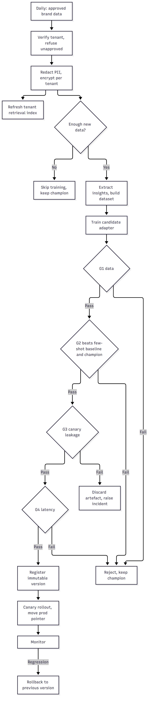

# Automated Learning Workflow

**As of 2026-11-01.** Written for engineers reviewing the design. "Daily ingestion and RAG refresh; adapter retraining is triggered, batched and gated." Nothing here is online learning.

## Summary

Each day, approved brand data is ingested and redacted, and that brand's retrieval data is refreshed. Separately, when enough training-eligible data has built up since the last run, a candidate adapter is trained. It must pass four gates before it reaches production. Every version is immutable and can be rolled back.

A tiny CPU classifier exercises the pipeline. No LLM has been trained.

## Why it is shaped this way

- **Facts go in RAG, not weights.** RAG beats fine-tuning for facts. In one study on current events, adding fine-tuning made RAG worse, 0.875 falling to 0.830 (R6-017, R6-018, R6-019).
- **Adapters must earn their place.** Small-data QLoRA showed limited utility, and no study has tested brand voice directly (R6-020, R6-025). Fine-tuning beat prompting on sentiment transfer and detoxification (R6-021), and prompted LLMs struggle with implicit style (R6-022). So the design says an adapter goes live only if it beats a few-shot prompt baseline on that brand's held-out data. That comparison is [DESIGN]: the POC's G2 compares against the champion only.
- **Scheduled, not online.** Evidence conflicts on forgetting, and no controlled comparison of online and scheduled retraining was found (R6-027, R6-028, R6-029). Scheduled is the conservative choice.
- **Retraining stays gated.** Daily fine-tuning would add cost and risk, and small daily additions rarely move a model. Retrieval already carries daily freshness.

## Pipeline

| Step | What happens | POC status |
|---|---|---|
| 1. Authorise | Tenant comes from the signed token, never from request data | [REAL: test_01_token_cannot_name_another_tenant] |
| 2. Approve | Only records marked approved enter | [REAL: test_ingest_refuses_unapproved_and_stores_no_pii] |
| 3. Redact | PII removed before storage | [REAL: test_redaction_removes_email_phone_and_handle] regex only. Production needs an NER-based redactor [DESIGN] |
| 3b. Tag | Source and training eligibility recorded per record | [REAL: test_platform_api_data_is_stored_but_never_trained_on] |
| 4. Store | Encrypted per tenant with a per-tenant key | [REAL: test_03_stores_are_keyed_and_encrypted]. Demo cipher; production uses KMS and AES-GCM [DESIGN] |
| 5. Refresh RAG | New records are searchable at once, by BM25 per query. A real index is [DESIGN] | [REAL: test_02_retrieval_returns_only_own_records] |
| 6. Extract insights | Term counts per label stored with the version | Rule-based, recorded by [REAL: test_versions_are_immutable_and_record_lineage]. LLM extraction is [DESIGN] |
| 7. Build dataset | Hashed, recorded in version metadata, disjoint from golden set | [REAL: test_versions_are_immutable_and_record_lineage] |
| 8. Train | Low-rank adapter trained on frozen base, after G1 passes | Tiny classifier [REAL: test_learning_improves_on_the_base_model] [REAL: test_bad_data_is_refused_before_training]. QLoRA is [DESIGN] |
| 9. Gate | G2 to G4 below | Same gates as the table below |
| 10. Promote | Atomic per-tenant pointer move, with rollback | [REAL: test_day_sequence] |

**Data sources.** The workflow trains only on what R7 permits; see [doc 04](04-social360-architecture.md). API engagement data is for live reporting, kept per tenant, and is not used for training unless the platform agrees in writing. `[COUNSEL]`

## Gates

| Gate | Passes when | On failure | Evidence |
|---|---|---|---|
| G1 Data | Enough examples, none overlapping the golden set, no PII hits, dataset hash recorded. Runs before training | Reject without training | [REAL: test_data_gate_rejects_golden_overlap_and_pii] |
| G2 Quality | Non-inferiority: the paired bootstrap lower bound of candidate minus champion is above -0.02 | Reject, champion stays | [REAL: test_quality_gate_decisions] |
| G3 Leakage | No other tenant's canary found as a literal string in the artefact | Discard artefact, keep metadata, log a leakage incident | [REAL: test_08b_leakage_gate_blocks_promotion] |
| G4 Latency | p95 within budget | Reject | [REAL: test_latency_gate_fails_a_slow_model] on CPU. The demo budget says nothing about LLM serving |

**Limits of these gates.** G2 is a non-inferiority test, so a candidate need not beat the champion. In the simulated run the day 4 promotions have small negative lower bounds. Repeated promotions could ratchet quality down by up to the margin each time, so production should also compare against a fixed reference. G3 only finds literal strings, and an adapter actually trained on a foreign canary passes it [REAL: test_08c_byte_scan_limit_is_real]. Production adds generated canary probes on the real model, because LoRA reduces membership leakage but does not remove it (R6-054, R6-055, R6-058).

**Simulated run.** `python -m poc.social360.run_daily` produces the following for two fictional tenants. [SIMULATED] days, [REAL: test_day_sequence] outcomes.

| Day | Event | Outcome |
|---|---|---|
| 1 | 60 new examples | Promoted over the base |
| 2 | 5 new examples | Skipped, too few |
| 3 | Fixture trainer on rotated labels | Rejected, champion stays |
| 4 | 40 new examples | Promoted |
| 5 | Operator rollback | Previous version restored |

Accuracy in that run moves from about 0.7 to about 0.9 on a synthetic task built so that the same word means opposite things per brand. It shows the machinery works. It says nothing about real brand data.

## Versioning

Each version records its dataset hash, the base file's hash, previous version, gate results and insights. Versions are never overwritten [REAL: test_versions_are_immutable_and_record_lineage]. Each tenant has its own `prod` pointer and history.

vLLM, SGLang and Ray docs define no adapter version concept. llm-d's name-to-version mapping with traffic shifting is the one pattern found (R6-032), so the registry owns versions and maps them to served adapter names. Swaps need matching target layers (R6-033), and mixed ranks raised P95 TTFT by 84% (R6-043), so one rank is fixed across the fleet.

## Benchmark protocol

No results exist yet. This is a protocol to pre-register once its blanks are fixed. No public brand-voice benchmark was found (R6 brief), so a private one must be built.

**Compare, per brand:**

1. Base model alone.
2. Base with few-shot examples.
3. Base with few-shot examples and RAG.
4. Base with RAG and adapter.
5. A commercial general-purpose LLM, under its terms.

**Tasks.** Sentiment and intent on the brand's comments, brand voice rewriting, comment replies, content calendar generation, and factual Q&A from brand documents.

**Rules, fixed before any run**

- Golden sets are held out, frozen, and hashed before training starts.
- Reviewers score blind, and inter-rater agreement is reported.
- Before any run, fix the sample size per task, the primary metric and the decision margin. Starting proposal `[ASSUMPTION]`: at least 200 golden items per task per brand, rubric pass rate as primary for voice, and a +0.05 win over option 3 to keep an adapter. Use the metric ensemble in R6-022 for voice.
- Results are reported with confidence intervals and failures, including null results.
- If adapters do not beat option 3, drop them, along with their serving, leakage and retraining costs.

**TweetEval** is usable for sentiment, though its licences vary by subset (R6-062). DeepEval and promptfoo are active; promptfoo is now part of OpenAI but stays MIT (R6-065, R6-067).

Until this runs on real held-out data, no comparative claim can be made. The Table 7 figures in the earlier report are not results.

## Monitoring and operations

Metrics carry counts and hashes, never content. [REAL: test_07_logs_and_metrics_hold_no_content] Watch retrieval hit rate, rejection rate per gate, adapter age, latency per adapter and feedback from reviewers.

Log FLOP per training run. It is cheap evidence that adapters stay under the GPAI modification threshold (R7-065, R7-067). `[COUNSEL]`
