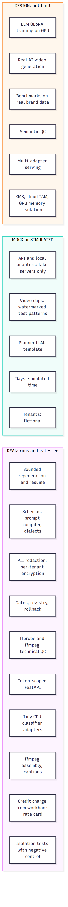

# Working Demonstration Plan

**As of 2026-11-01.** Written for the team running the demo, and for a diligence reader checking what is real.

## What this demo proves

It shows the control logic of both pipelines running on a laptop with no keys: planning structure, QC, regeneration, gates, versioning and tenant separation. It does not show AI-generated video or a trained LLM, and it skips several production stages listed below.

Say this out loud: "These clips are watermarked test patterns, and a tiny CPU classifier stands in for the LLM. What you're seeing is the pipeline, the gates and the isolation."



| Part | Status |
|---|---|
| Storyboard schema, prompt compiler, provider dialects | [REAL: test_dialects_render_exclusions_their_own_way] The demo uses `generic` unless `--dialect` is set |
| ffprobe and ffmpeg QC, bounded regeneration, resume cache | [REAL: test_regeneration_recovers_from_fault] |
| ffmpeg assembly with captions | [REAL: test_five_minute_mock_run] Audio is a placeholder tone |
| Credits charged from the workbook's rate card | [REAL: test_rate_card_matches_the_workbook] |
| PII redaction, per-tenant encryption, token-scoped API | [REAL: test_03_stores_are_keyed_and_encrypted] Regex redaction and a demo cipher. The API runs in-process, not on a network |
| Gates, registry, rollback, literal canary scan | [REAL: test_day_sequence] [REAL: test_08b_leakage_gate_blocks_promotion] |
| Isolation tests with negative controls | [REAL: test_isolation.py] One machine, application level. The negative controls show the detectors fire on planted leaks, not that they catch every leak |
| Video clips | [MOCK] watermarked ffmpeg test patterns |
| Planner | [MOCK] deterministic template |
| API and local adapters | [MOCK] tested against fake servers, never a live provider |
| Days, tenants | [SIMULATED] |
| Narration and captions | [MOCK] template strings |
| Real generation, semantic QC, QLoRA, multi-adapter serving, KMS, cloud isolation, benchmarks | [DESIGN] |
| Asset approval, keyframes, repair, reroute, voice, music, lip-sync, colour match, normalisation, loudness | Not in the POC at all |
| Connectors, scheduling, consent, retention | Not in the POC at all |

## Run it

From the repo root, on Windows, with Python 3.14, ffmpeg and the packages in `poc/requirements.txt`:

```powershell
powershell -ExecutionPolicy Bypass -File poc\run_demo.ps1
```

This runs both flows and needs no keys and no spend. The 5-minute test took between 29 seconds and about 5 minutes depending on machine load, so it is excluded from the live run.

## Video flow: about 2 minutes

**User input > Storyboard > Clips > Final video**

```powershell
python -m poc.video.cli --fresh --seconds 30 --fault sc01_sh02:1:black --fault sc02_sh01:1:frozen
```

Use `--fresh`. Without it the shot cache answers and QC never runs, so attempts show 0.

| Step | Show | Point to make |
|---|---|---|
| 1 | `poc/video/sample_brief.json` | A brief with a character, a product and a style bible |
| 2 | `poc/runs/video/storyboard.json` | Canonical text appears in every shot prompt |
| 3 | Dry-run routing output | Against the real catalog: Blocked refused, Counsel held for legal sign-off, Wan 2.2 chosen. No call is made, and the run itself uses the mock |
| 4 | `total_attempts: 8` | 6 shots plus 2 regenerations: QC caught the injected black and frozen clips |
| 5 | `final.mp4` | Watermark on every frame, real assembly, caption track |
| 6 | `manifest.json` | Prompt hashes, attempts, QC results, `real_generation: false`, `semantic_qc: not_evaluated`, credits |

## Social 360 flow: about 2 minutes

**Secure ingestion > Automated learning > Evaluation > Updated model > Production API**

```powershell
python -m poc.social360.run_daily
python -m pytest poc/tests/test_isolation.py -v
```

| Step | Show | Point to make |
|---|---|---|
| 1 | Banner | Synthetic data, fictional tenants, simulated days |
| 2 | Day 1 | Ingests, redacts PII, refuses unapproved records, trains, promotes |
| 3 | Day 2 | Too little data, so no training |
| 4 | Day 3 | Bad candidate rejected, champion stays |
| 5 | Day 4 and 5 | Promotion, then rollback |
| 6 | In-process API call | Version header, a classifier label, and retrieval limited to that tenant. It is not a generated answer |
| 7 | `test_08_negative_control` | The detectors fire on a deliberate leak. They find planted strings; they do not prove the absence of learned leakage |

## Questions to expect

| Question | Honest answer |
|---|---|
| Is this AI video? | No. The clips are test patterns. The API path is built but has never called a live provider |
| Have you trained a model? | A tiny classifier, on CPU, to exercise the pipeline. No LLM has been trained |
| What's the cost of a 5-minute video? | It depends mainly on accept rate, which nobody has reliably published. See [doc 06](06-gpu-deployment-cost-assessment.md) for the range. A pilot is the next step |
| Is tenant data safe? | No path was found through the current API, and review found and fixed two code-level paths on the way. It is one machine, no penetration test. Cloud and GPU isolation are designed, not built |
| Do you learn across customers? | No. Tenant data never reaches the shared base. That is a deliberate trade-off |
| Do you beat GPT or Claude? | Unknown. The benchmark protocol exists, and results need real held-out data |

## Next demo: with real footage

This is more work than adding a key. The CLI runs only the mock today, so a provider config and a CLI route must be written. The API adapter's payload mapping must be confirmed against the provider's docs, because it has never run live. Provider legal terms must also be cleared first ([doc 01](01-video-models-and-pricing.md)). `ApiAdapter` already refuses to start without a key and a spend cap.

A live GPU demo of LoRA hot-swapping, as proposed in the earlier report, needs a rented cluster, a trained adapter and a smoke test of vLLM LoRA on the chosen base (R5-104). None of those exist yet, so it is a later milestone.
