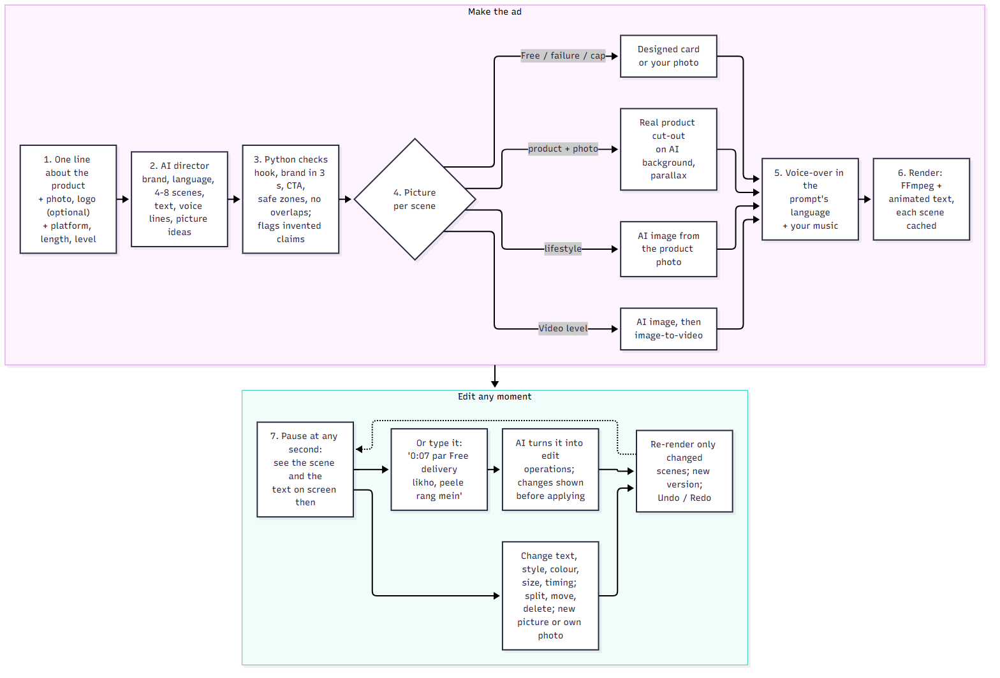

# 11. Synquic Ad Studio: system design, APIs and status

As of 2026-11-15. Code: `web_ec2/` (ad_director.py, ad_engine.py, media_providers.py, ad_routes.py, templates/editor.html). Costs marked [ESTIMATE] use list prices; licence points need counsel [COUNSEL].

## 1. What it does

A user types one line about any product, in English, Hindi or Hinglish, and optionally adds a product photo and a logo. The studio returns a finished short social ad of 6 to 60 seconds with pictures, animated text, a voice-over in the same language and a call to action. The user can then pause the ad at any second and change exactly what is on screen there, by hand or by typing what they want. Only the changed scenes re-render, and every change can be undone.

What is new compared with the tools we studied (Creatify, Arcads, HeyGen, invideo, Pictory, Topview, Pippit, AdCreative, Predis, Holo):
- **Edit at any moment.** Those tools edit at scene or script level. Only invideo's Agent Two turns typed requests into timeline edits, and none documents "pause anywhere and change what is visible there".
- **The real product stays exact.** The product is cut out of the user's photo and kept as its own layer over an AI background, so its label and logo are never redrawn by a model. No hosted video model keeps product pixels exact (our research).

## 2. How it works

1. **Plan.** An LLM "director" writes the brand, language, 4 to 8 scenes (hook, benefits, call to action), the on-screen text, a voice line per scene and a picture idea per scene. Emits distinct `on_screen_text` (Latin script for Hinglish/English) and `voice_line_tts` (Devanagari for Hindi TTS engines).
2. **Python checks & safe zones.** Code enforces ad rules deterministically across platforms using exact safe bounding box pixel geometry:
   - Instagram Reels (1080×1920): `(65, 269) → (1015, 1248)` (Top unsafe 269px / 14%, Bottom unsafe 672px / 35%, Sides 65px / 6%).
   - YouTube Shorts (1080×1920): `(65, 192) → (972, 1440)` (Top unsafe 192px / 10%, Bottom unsafe 480px / 25%, Right unsafe 108px / 10%).
   - Meta Feed (1080×1350): `(54, 108) → (1026, 1148)` (Top unsafe 108px / 8%, Bottom unsafe 202px / 15%, Sides 54px / 5%).
   - Meta Reels HD (1440×2560): `(86, 358) → (1354, 1664)` (Top unsafe 358px / 14%, Bottom unsafe 896px / 35%, Sides 86px / 6%).
   Text anchors are clamped mathematically in Python before calling an LLM repair pass.
3. **Pictures & Silky 2.5D Parallax.** Product scenes keep exact product pixels (Bria RMBG cut-out) floating over an AI background. Backgrounds are upscaled 2x (2160×3840) with smooth zoompan downscaled to canvas, while the product cutout moves via floating-point time-based overlay expressions (`x='(W-w)/2 + 18*sin(2*PI*t/8)':y='(H-h)*0.48 - 12*(t/duration)'`), completely eliminating integer-rounding zoompan jitter.
4. **Sound & Audio-Safe Split.** High-fidelity voice-over with automated trim offsets (`voice_trim_start`, `voice_trim_end`). Splitting a scene preserves the original voice stem without repeating or re-synthesizing.
5. **Render & Disk Guard.** FFmpeg with libass text overlays. An automated LRU cache sweep frees unreferenced MP4/WAV stems older than 24 hours whenever disk space drops below 3.5 GB, and unlinks intermediate `.ass` and `.wav` mix stems immediately after final mux.
6. **Edit & Atomic Tool Operations.** Pausing at second `t` invokes `elements_at(t)` returning `{scene_id, scene_index, t_scene, visual_layer, active_text_layers}` with safety badges ("Exact Product Layer" vs. "AI Lifestyle Preview"). `/api/ads/{id}/instruct` runs typed atomic operations on a dry-run copy, producing `diff_summary`, `estimated_cost_usd`, and `pending_patch` with 30-revision undo/redo stack (`versions[]` and `version_ptr`).

### Templates & Glassmorphic Aesthetic (added 2026-11-16)

A template fixes an ad's structure (scenes, timing, picture type per scene, text slots with their animation and position, and a look: glow, dark, light, bold, festive, or **glass**). The `"glass"` card look implements true frosted glassmorphism: procedural translucent panels (`rgba(255,255,255,0.08-0.14)`), specular top-left highlight borders, ambient chromatic bokeh leaks, and floating text/product layers. 42 templates ship in `web_ec2/ad_template_library/` (including `glass_luxury_minimal` and `glass_glow_saas`), all validated with zero errors and live since 2026-11-16. The glow, dark, light and glass looks use studio and photo backgrounds (numpy needed on the server); bold and festive stay flat brand-colour cards so the brand colour and text contrast hold. The background photos' licence is unconfirmed [COUNSEL].

## 3. Quality levels and cost per ad

For a 15-second ad of 5 scenes [ESTIMATE]:

| Level | Pictures | Cost per ad |
|---|---|---|
| Free | Designed cards and the user's own photo, with animated text | $0 |
| AI images (default) | AI backgrounds and lifestyle images, the real product cut-out | about $0.20 ($0.22 with a product photo, for the cut-out) |
| AI video | As above, plus image-to-video on 2 scenes of 3 s | about $0.40 to $1.55 by video model; about $0.80 with the current default (Wan 2.7) |

Each ad has a hard spend cap (default $3). Paid levels need an explicit "I confirm this spend" and a studio password on a public server.

## 4. APIs to buy (for sir)

| Need | Production pick | Price | Backup | Used for testing now |
|---|---|---|---|---|
| AI director (plans and typed edits) | The platform's existing Groq, Cerebras or OpenRouter credits, any OpenAI-compatible model | small per ad | another of the three | NVIDIA trial key (testing only, see below) |
| Pictures, cut-out, video | **fal.ai**, one prepaid key (start with about $50) | Nano Banana 2.1 image about $0.04; Bria cut-out $0.018; video $0.03 to $0.23 per second by model | Photoroom API Plus, $0.10 per image (includes relighting) | none |
| Voice-over | **Google Cloud Text-to-Speech, Chirp 3 HD** (hi-IN and en-IN) | first 1M characters a month free, then $0.03 per 1,000 characters | ElevenLabs or Cartesia (Hinglish in Latin script) | edge-tts (free, test quality) |
| Music customers may use in paid ads | **Epidemic Sound Partner API**, Scale tier (it allows sub-licensing to end users) | by sales call | Mubert Startup+ ($499 a month; ads use unclear) | user uploads own track |
| Server | Existing EC2, but the disk is 89% full | grow to 30 GB or more, or move media to S3 / R2 | | |

Also ask sir to decide: whether Chinese-origin video models may be used (it changes which video model wins), and who will check the music licence for customers' paid ads [COUNSEL].

**Why not NVIDIA for production:** the NVIDIA API trial terms allow access "for limited trial purposes only and without use of the API Service or Generated Content in production" (§1.2) and bar distributing generated content (§4.2). Production on NVIDIA needs NVIDIA AI Enterprise ($4,500 per GPU per year, or $1 per GPU-hour on cloud marketplaces) and our own GPUs. NVIDIA also has no creative video model (Cosmos is built for robotics) and no image background removal.

## 5. What is built and how it was checked

| Part | Status | Evidence |
|---|---|---|
| AI director | Built | 11 unit tests with a fake LLM. Live test on the NVIDIA trial key (testing use): 6 prompts (honey, sneakers, billing software, real estate, Hindi restaurant, printed T-shirt) all planned by the AI, 2.7 to 4.6 s each in the final run; typed edits understood in under 1 s |
| Picture and voice adapters | Built | 4 tests with a fake transport: each video model's own field names and duration types, one retry with essential fields if a field is rejected, voice fallback |
| Render engine | Built | 22 tests with real FFmpeg: sizes for every platform, safe zones, text animates, product layer and parallax, logo, split with continuous voice, Hindi font, only changed scenes re-render, cache sweep |
| Studio routes and editor | Built | 14 tests with fakes: free, AI-images and AI-video flows, spend cap, password, paid lock behind a proxy, typed edit then apply, undo/redo, logo, music, scene photo, failed regeneration keeps the old picture, unsafe file names refused |
| Editor in a browser | Pass | headless Edge: one-line prompt to ad, pause on the timeline, typed edit with diff, apply, undo, inline edit, split, download; no page errors |
| Older app tests | Pass | 18 |

Problems found and fixed during the live test:
- The NVIDIA model spent all its tokens on hidden reasoning and returned no answer; thinking is now switched off for that endpoint (answers in about 3 s).
- The LLM invented facts ("trusted by 5000+ shops", "30 Days Free Trial", a phone number). The plan prompt now forbids them and Python flags any that remain.
- Hindi picture descriptions came back in Hindi; they are now always in English for the image models.

## 6. Not verified yet

- **No paid image or video call has been made.** The fal field names come from the vendors' pages and were never test-called. The first run with a key should be a small one.
- The real cut-out quality (Bria) and how well Nano Banana keeps a product from a photo are unmeasured.
- TikTok's own safe-zone template could not be read; the Reels zones plus room for the right-hand buttons are used.
- Live since 2026-11-16 at http://13.205.82.99/editor, Free level only (no fal key, no studio password yet). Hindi uses the Lohit Devanagari font; Noto can replace it once the disk is grown.
- Director on the live server since 2026-11-16: **google/gemma-4-31b-it on OpenRouter** (NVIDIA trial key kept only as a fallback setting). Chosen from a test of 6 OpenRouter models on the 6 test prompts plus 2 typed edits: Gemma 4 31B, Mistral Small 2603 and gpt-oss-120b planned 6 of 6 with the AI; DeepSeek V4 Flash 4 of 6; Qwen 3.7 Flash 1 of 6 (too slow); the free Gemma endpoint was rate-limited. Gemma put text on every scene, wrote clean Hindi and Hinglish and added no claims; Mistral left 4 scenes of one ad without text; gpt-oss-120b added "Trusted by small shops". All tests together cost $0.016, so the director costs well under $0.01 per ad.
- edge-tts is an unofficial free endpoint, fine for tests only.
- The editor was driven in a headless browser (create, pause on the timeline, typed edit, apply, undo, inline edit, split, download: 10 of 10 checks, three runs), but no real user has tried it yet.

## 7. Next steps

1. **When the fal key arrives:** one smoke test (about $3), then real ads for the 6 test prompts on the default level; look at every frame; record the real cost per ad.
2. **Production keys:** point the director at Groq, Cerebras or OpenRouter; switch voice to Chirp 3 HD; sign the music licence.
3. **Deploy:** install `fonts-noto-core`, set `STUDIO_PASSWORD`, grow the disk, then deploy with a staging test, backup and automatic rollback, as on 2026-11-11.
4. **Pilot** with 2 or 3 brands and collect which edits people actually make.

## Appendix: settings

| Variable | Meaning |
|---|---|
| `DIRECTOR_BASE_URL`, `DIRECTOR_MODEL`, `DIRECTOR_API_KEY` | Any OpenAI-compatible LLM for the director. Without them it falls back to `NVIDIA_API_KEY` (trial), then to rules |
| `DIRECTOR_EXTRA_BODY` | Extra request fields as JSON. On NVIDIA it defaults to turning thinking off |
| `FAL_KEY` | Pictures, cut-out and video |
| `AD_IMAGE_MODEL`, `AD_IMAGE_EDIT_MODEL`, `AD_CUTOUT_MODEL`, `AD_VIDEO_MODEL` | Model choices; video options: wan27, kling4, minimax_h3, seedance25, omni_flash, heygen_video1 |
| `AD_PRICE_*_USD`, `AD_MAX_SPEND_USD` | Prices used for estimates and the cap per ad (default $3) |
| `TTS_PROVIDER` | google, elevenlabs or edge; with `GOOGLE_TTS_API_KEY` or `ELEVENLABS_API_KEY` and `ELEVENLABS_VOICE_ID` |
| `STUDIO_PASSWORD` | Password for the whole site (user `studio`); needed for paid levels on a public server |
